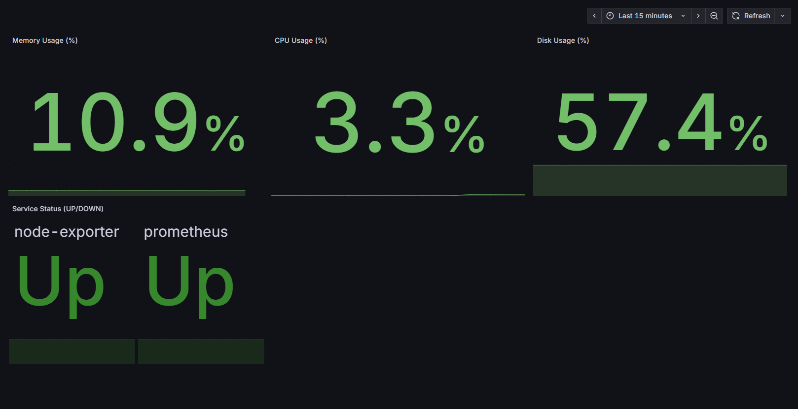

# Docker Infrastructure Lab

A containerized infrastructure monitoring lab built with Docker Compose, Prometheus, Node Exporter and Grafana.

## Overview

This project demonstrates how to deploy and monitor containerized infrastructure using open-source tools.

## Technologies

- Docker & Docker Compose
- Prometheus
- Grafana
- Node Exporter
- Linux / WSL2

## Features

- CPU usage monitoring
- Memory usage monitoring
- Disk usage monitoring
- Service availability monitoring
- Persistent Docker volumes
- Automated Grafana dashboard provisioning
- Isolated Docker networking

## Architecture

Node Exporter → Prometheus → Grafana

Node Exporter exposes system metrics, Prometheus collects them, and Grafana displays them through a monitoring dashboard.

## Getting Started

### Requirements

- Docker Engine with Docker Compose
- Linux or Windows with Docker Desktop and WSL2

### Start the infrastructure

```bash
docker compose up -d
```

### Access the services

- Grafana: http://localhost:3000
- Prometheus: http://localhost:9090
- Prometheus targets: http://localhost:9090/targets

Note: Grafana's Prometheus data source currently requires manual configuration. Set its URL to `http://prometheus:9090` and its UID to `prometheus`.

## Dashboard



## Troubleshooting

During development, I diagnosed and resolved Docker network isolation issues affecting communication between Grafana, Prometheus and Node Exporter.

## Future Improvements

- Fully automated data source provisioning
- Alerting rules
- Container-level metrics
- Automated deployment testing
